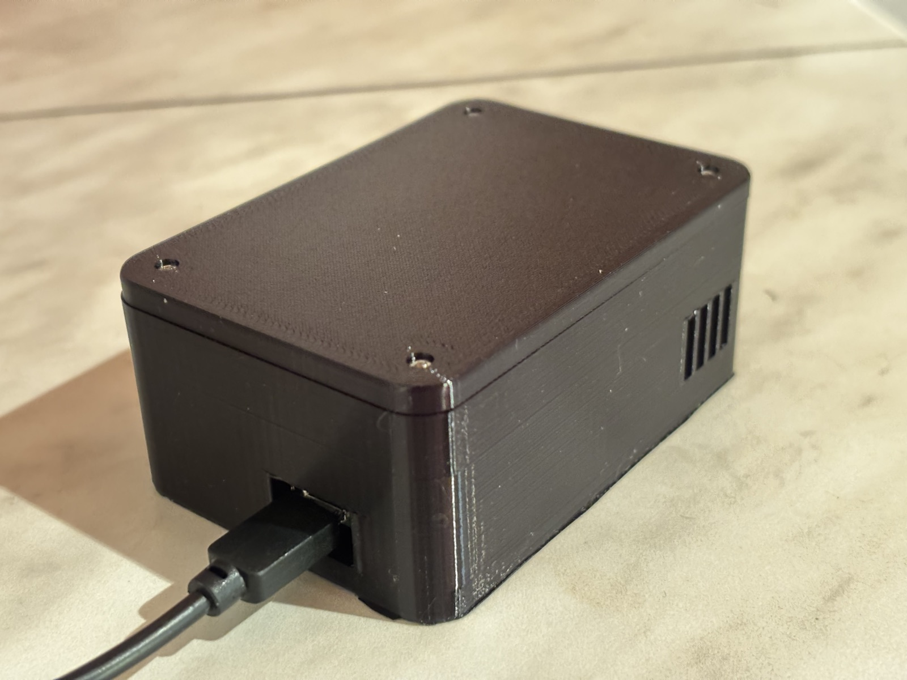
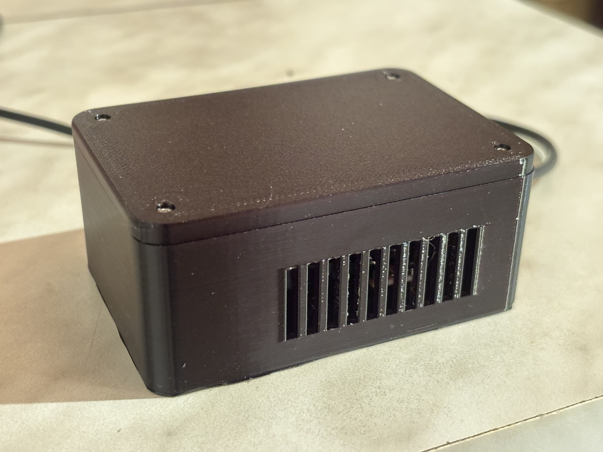
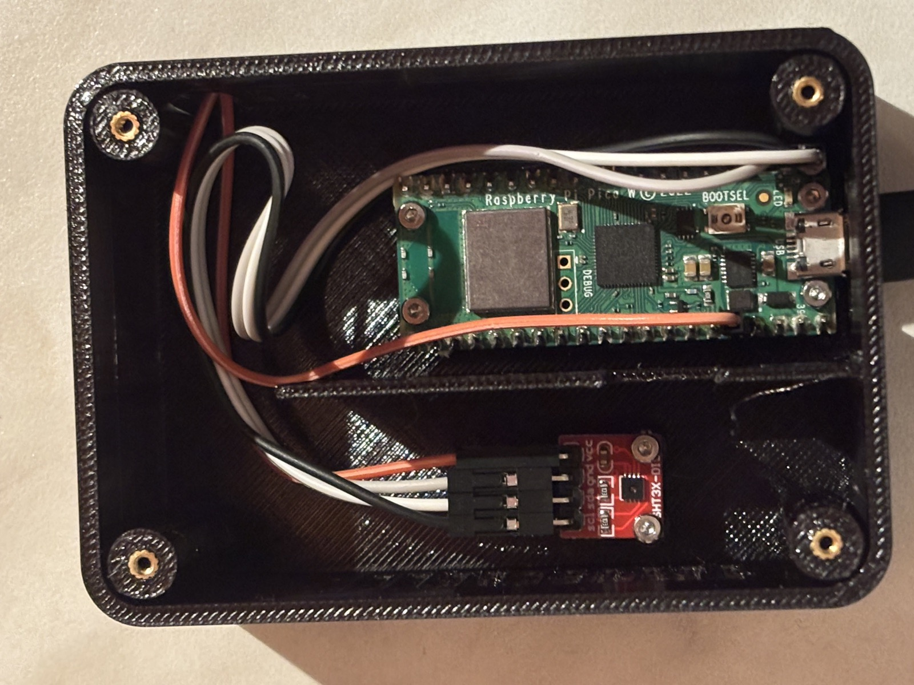
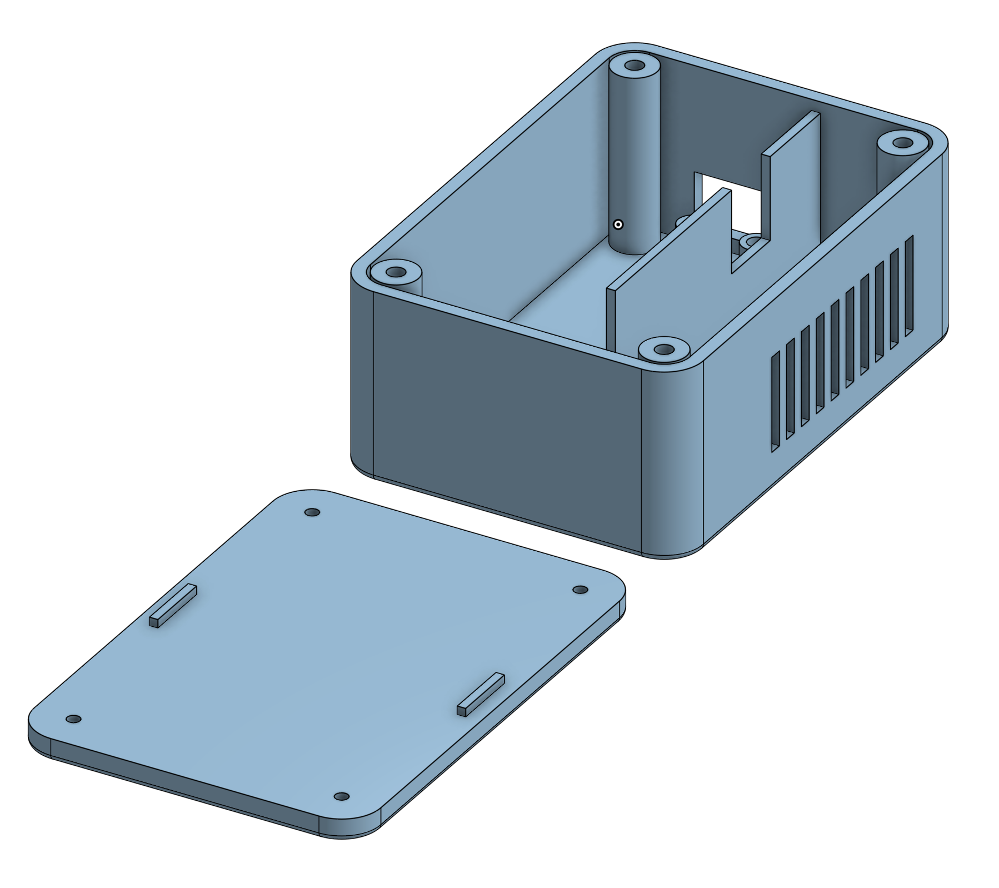
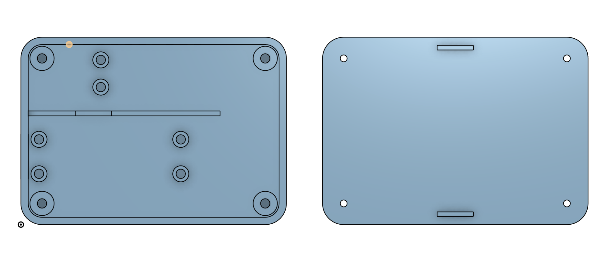

# Room

My little bedtime weather station. I like my room around 16-18°C for sleep. A quick check tells me whether to crack a window, turn on the heating, or borrow some warmth from another room. Less guessing, more cozy sleep.

Pico 2 W + SHT3x → FastAPI + SQLite → React dashboard. Temperature and humidity, updated every minute.

## The build



| Ventilation | Inside |
| --- | --- |
|  |  |

GPT-6 Astra designed the enclosure; I printed it on my Creality K1C in PETG. The [Onshape FeatureScript source](enclosure/room_v02.fs) is included.

| Onshape model | Body and lid |
| --- | --- |
|  |  |

## Quick setup

1. Wire the SHT3x to the Pico: VCC → 3V3, GND → GND, SDA → GP0, SCL → GP1.
2. Install MicroPython for Pico 2 W. Copy `firmware/secrets.example.py` to `firmware/secrets.py`, fill in Wi-Fi credentials and a random API token, and adjust `STATIC_IPV4` in `firmware/config.py` for your LAN. Upload the firmware modules and `secrets.py` to the Pico root, with `main.py` last.
3. Copy `.env.example` to `.env`. Set `PICO_IP` to the Pico address and `PICO_TOKEN` to the same API token, then run:

```bash
docker compose up -d --build
```

Open **http://127.0.0.1:8765** on the Docker host. The backend must be able to reach the Pico over LAN. Readings persist in a Docker volume; keep `.env` and `secrets.py` private.
